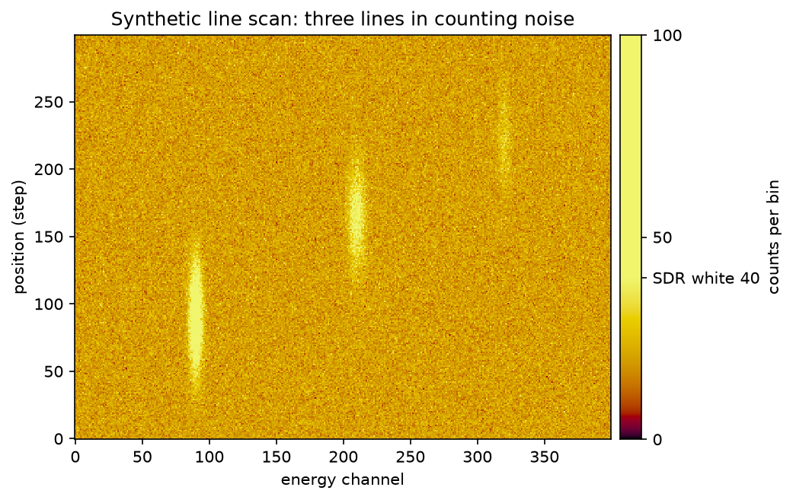
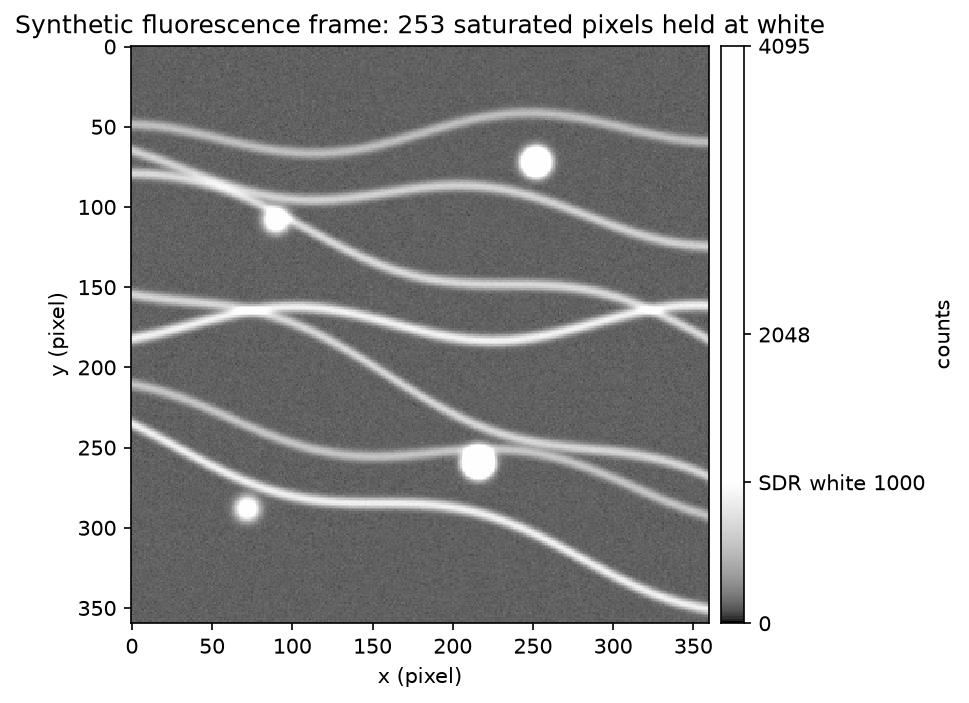
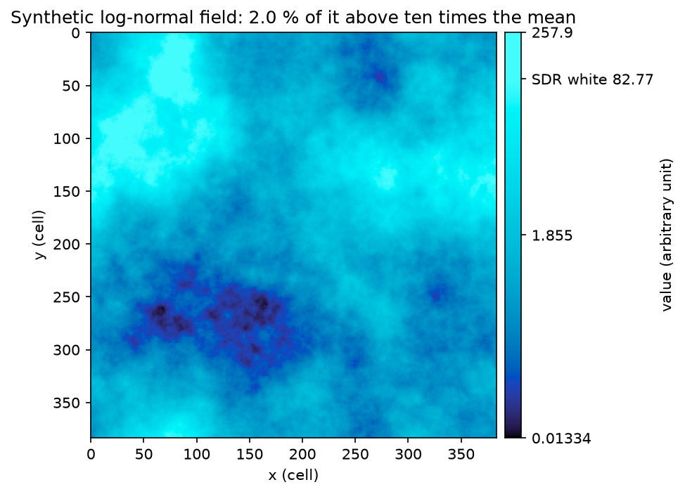

# Worked examples

Four short scripts. Each makes its own data, so it runs with nothing but the package and matplotlib:

```sh
python -m pip install "udeep[mpl] @ git+https://github.com/ultradeeprange/udeep"
python examples/spectral_map.py
```

All the data here is **synthetic**: made by the script, seeded, and labelled as such in each figure's title. The
pictures below are the ordinary (SDR) figures; beside each in [`output/`](output/) is the UDeep file
(`*_hdr.jpg`), which is the same picture on an ordinary screen and shows the values above white on an HDR one.
Every script checks its file against the profile and prints the caption the file's own declaration gives.

The first three are about **range**: where to put white, and why. The fourth is about **depth**: how many levels a
file holds, and what it may call itself.

## A statistical knee: [`spectral_map.py`](spectral_map.py)

<picture><source media="(prefers-color-scheme: dark)" srcset="output/spectral_map_dark_sdr.png"></picture>

A line scan with three lines in Poisson noise, one of them weak. White is put at the smallest count that noise
alone reaches with a probability of one in 10,000 or less: 40 counts on a background of 20, worked out from the
Poisson tail in the script. So a bin brighter than white is one that noise would rarely give. This is *Highlight*:
the figure below white is the ordinary one, and only the rare bins are lifted.

## A preset knee, and a mask: [`microscope_frame.py`](microscope_frame.py)

<picture><source media="(prefers-color-scheme: dark)" srcset="output/microscope_frame_dark_sdr.png"></picture>

A 12-bit camera frame with faint filaments and four bright beads, two of which saturate the camera. White is put
at 1,000 counts, just above the brightest filament, so the filaments keep the whole ordinary figure and the beads
go above white (*Extend*). A saturated pixel is a lower bound and not a measurement, so those pixels are given as
a mask: they stay at white, and the file records how many there were.

## A logarithmic stretch: [`simulation_field.py`](simulation_field.py)

<picture><source media="(prefers-color-scheme: dark)" srcset="output/simulation_field_dark_sdr.png"></picture>

A log-normal field standing in for a simulated quantity that is quiet nearly everywhere and intense in a small
part. It is not the output of a solver. The stretch is logarithmic, and white is at ten times the field's mean.
No noise is stated for it, so the file declares the noise unknown, and for that reason alone it could not be a
data record.

## Depth: [`detector_record.py`](detector_record.py)

One 12-bit detector frame, with a read noise of 3 counts, stored twice with the same mapping:

| File | Levels across the range | Widest step | Rounding against the noise (limit 0.1) | The file declares itself |
|---|---|---|---|---|
| 8-bit gain-map JPEG | 375 | 36.6 counts | 3.5 | a rendering |
| 16-bit PQ PNG | 37,559 | 0.58 counts | 0.056 | a data record |

The JPEG shows the frame; its levels are twelve times wider than the noise, so it cannot stand in for the data
and says so. The PNG's levels are finer than the noise allows for, so it may be called a data record, and the
script shows what that means: it reads the PNG back, turns its codes into light and the light into counts, and
gets the frame itself, every pixel, to the whole count.

The numbers in the table are what the script prints. The package works out the levels of its 8-bit path itself;
the 16-bit levels are worked out in the script, from the same functions the PNG writer uses.
